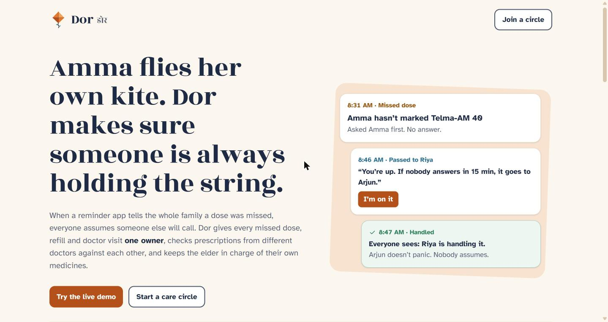
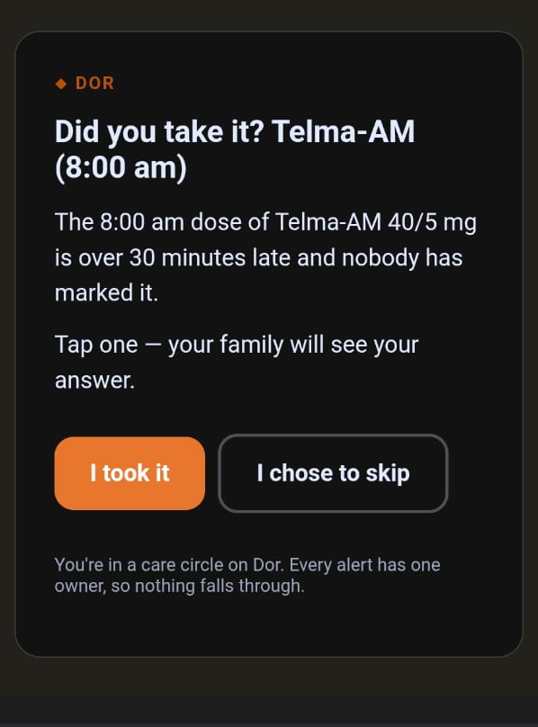
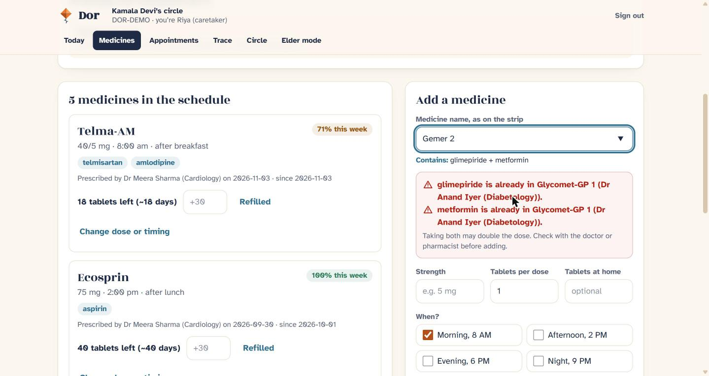
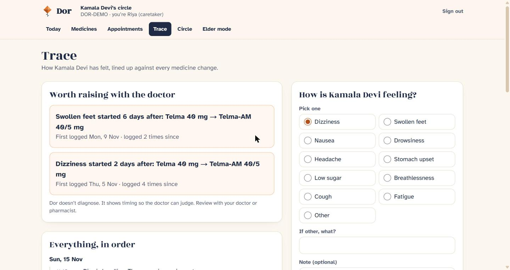
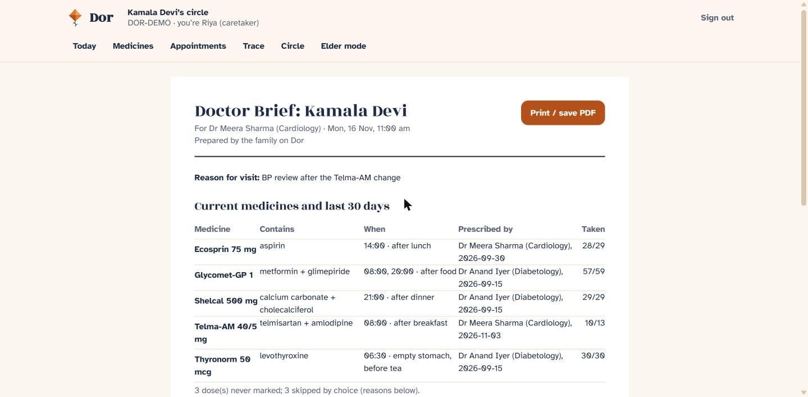
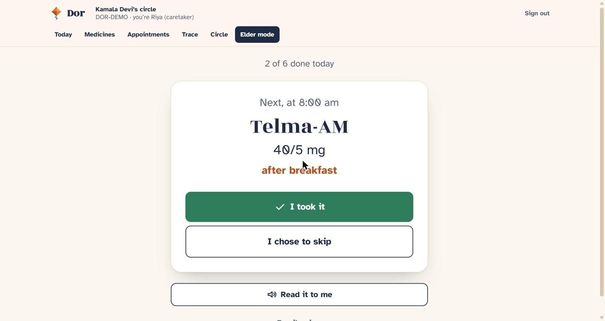
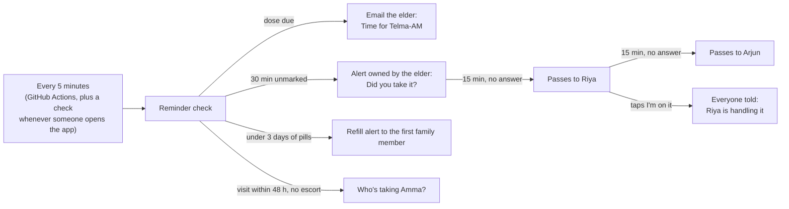

<p align="center">
  
</p>

<h1 align="center">Dor · डोर</h1>

<p align="center">
  <strong>Amma flies her own kite. Dor makes sure someone is always holding the string.</strong>
</p>

<p align="center">
  A care circle for an elder’s medicines and doctor visits, where every missed dose has an owner,<br/>
  every prescription is checked against the others, and the elder stays in charge.
</p>

<p align="center">
  <a href="https://dor-sandy-two.vercel.app"><b>Open the live app</b></a>
  &nbsp;·&nbsp;
  <a href="https://dor-sandy-two.vercel.app/#demo"><b>Try the demo (no sign-up)</b></a>
  &nbsp;·&nbsp;
  <a href="#features">Features</a>
  &nbsp;·&nbsp;
  <a href="#how-it-works">How it works</a>
</p>

<p align="center">
  
</p>

---

## Why Dor exists

Medication reminder apps already exist. Family dashboards already exist. What still goes wrong for elders is simpler, and more human:

| What goes wrong | What Dor does about it |
|---|---|
| **Nobody owns the alert.** A missed-dose message reaches four siblings and each assumes someone else called Amma. | **Hold:** every alert has exactly one owner at a time, and it moves down the family chain until someone says *“I’m on it”*. |
| **Nobody sees the whole prescription list.** Three doctors, three prescriptions: Telma-AM already contains amlodipine, so adding Amlong doubles it. | **Check:** Dor knows the active ingredient (salt) behind common Indian brands and flags the same salt arriving twice, naming both doctors. |
| **Nobody connects how she feels to what changed.** “She’s been dizzy” reaches the doctor without “since the dose went up”. | **Trace:** symptoms are lined up against every medicine change, then printed on a one-page **Doctor Brief**. |
| **Care turns into surveillance.** The elder becomes a red “MISSED” on someone else’s phone. | **The elder stays in charge:** they are asked first, approve every change, and can choose to skip with a reason. |

> **Try it in 30 seconds.** Open the [live app](https://dor-sandy-two.vercel.app/#demo) and press **Enter as Riya (caretaker)** to see the family view, or **Enter as Kamala (elder mode)** to see what the elder sees. The demo is Kamala Devi, 74: three doctors, a daughter (Riya) who is her caretaker, and a son (Arjun) in Pune.

---

<a id="features"></a>

## Features

### 1. Hold: one owner for every moment

<p align="center">
  
</p>

The **Today** page opens on *Needs someone*: every open alert, who it is with right now, and how long until it passes on.

- **Missed doses.** If a dose isn’t marked within 30 minutes, Dor asks the **elder first** (“Did you take it?”). No answer in 15 minutes, it goes to the next person in the chain, then the next.
- **Refills.** When a strip has under 3 days left, Dor asks *“who’s buying more?”*, starting with the first family member.
- **Doctor visits.** Two days before a visit with nobody taking them, Dor asks *“who’s taking Amma?”*.
- **“I’m on it.”** The moment one person taps it, in the app or straight from the email, escalation stops and **everyone else is told who is handling it**. Nobody doubles up, nobody assumes.

<p align="center">
  
</p>

The **Circle** page shows the chain itself: the elder is always link 1, and the family can reorder everyone else. A history of every alert, who took it and how it ended sits beside it.

### 2. Emails you can act on

Every reminder is a real email with one-tap buttons. Nobody needs to open the app to respond.

<table>
  <tr>
    <td width="25%" valign="top"></td>
    <td width="25%" valign="top"></td>
    <td width="25%" valign="top"></td>
    <td width="25%" valign="top"></td>
  </tr>
  <tr>
    <td align="center"><sub><b>The elder is asked first.</b><br/>“I took it” or “I chose to skip”.</sub></td>
    <td align="center"><sub><b>An errand finds an owner.</b><br/>One tap claims the visit.</sub></td>
    <td align="center"><sub><b>Refills before they run out.</b><br/>Passed on if nobody answers.</sub></td>
    <td align="center"><sub><b>Visit reminders</b><br/>24 hours and 2 hours before.</sub></td>
  </tr>
</table>

Email buttons open a short confirm page, and only the button on that page acts. Mail scanners that pre-open links can’t press anything by accident, and links expire after 24 hours.

### 3. Check: same salt, different brand

<p align="center">
  
</p>

Type a medicine the way it’s printed on the strip (*“Gemer 2”*, *“TELMA-AM 40”*, *“dolo650”*). Dor shows what’s inside it and **warns while you type** if any ingredient is already in another medicine, naming the prescribing doctor. About 150 common Indian brands are mapped, including combinations like Telma-AM, Glycomet-GP and Ecosprin-AV. For a brand Dor doesn’t know, it asks for the ingredient printed under the name.

<p align="center">
  
</p>

The Medicines page keeps a standing warning for every duplicate, with each doctor and date, so the family can raise it at the next visit.

### 4. Trace and the Doctor Brief

<p align="center">
  
</p>

Anyone in the circle can log how the elder feels in one tap (dizziness, swollen feet, nausea…). Reasons given for skipping a dose, like *“felt dizzy”*, are logged too. **Trace** lines all of it up against every medicine change and points out symptoms that first appeared within 7 days of a change. Dor doesn’t diagnose; it shows the timing so the doctor can judge.

<p align="center">
  
</p>

Every appointment has a printable **Doctor Brief**: current medicines with their ingredients and prescribers, 30-day adherence per medicine, duplicate warnings, symptoms that began after a change, doses skipped in the elder’s own words, and questions the family collected for the doctor.

### 5. The elder stays in charge

<p align="center">
  
</p>

- **Elder mode** shows one thing at a time: the next medicine, in large type, with two big buttons and **Read it to me** (the browser’s own voice, no extra service).
- **Approval.** When family adds or changes a medicine, it waits as *pending* until the elder approves it. Nothing enters their schedule behind their back.
- **“I chose to skip”** is a valid answer. Family sees the reason (*“felt dizzy”*), not a red alarm, and the reason feeds Trace.
- Set in **Atkinson Hyperlegible**, a typeface designed for low-vision readers.

### 6. A shared circle with a passcode

One person creates a circle for the elder and gets a code like `DOR-4F7K`. Family and caretakers join with the code and the shared passcode. Passcodes are hashed, and five wrong tries pause the circle for 10 minutes.

---

## Problem-statement checklist

| Requirement | Where it lives in Dor |
|---|---|
| Shared profile with secure, passcode-based access | Start or join a circle (code + passcode, scrypt-hashed, lockout after 5 tries) |
| View, add, edit and manage medication schedules | Medicines page; every change is a new version the elder approves |
| Track adherence | Today (7-day %), per medicine, and 30-day table on the Doctor Brief |
| Monitor upcoming doctor appointments | Appointments page, escort claiming, questions for the doctor |
| Email reminders: upcoming doses, missed doses, appointments | Dose reminders, missed-dose alerts with escalation, 24 h / 2 h visit reminders, refill alerts, all with one-tap buttons |
| Elder at the centre of their own decisions | Asked first, approves changes, can skip with a reason, Elder mode |

---

<a id="how-it-works"></a>

## How it works



- **Next.js 15** (App Router, server components and server actions), deployed on **Vercel**.
- **Postgres on Neon**, queried with parameterised tagged templates. Schema in [`db/schema.sql`](db/schema.sql).
- **Email** through Gmail SMTP, capped per recipient and per day so the sending account stays in good standing.
- **The reminder check** ([`lib/tick.ts`](lib/tick.ts)) runs every 5 minutes from a [GitHub Actions workflow](.github/workflows/tick.yml), because Vercel’s free plan allows only a daily cron. As a backup, it also runs (at most once per 5 minutes) when someone opens the app. It is idempotent: overlapping runs never send an email or raise an alert twice.
- **Security.** Signed, expiring email links that act only on POST. Passcode lockout that holds up against parallel guesses. Every query scoped to the signed-in circle. No framing by other sites.
- **Tested core.** Dose timing, escalation, brand-to-salt matching, Trace flags, tokens and passcodes live in small pure modules in [`lib/`](lib) with unit tests in [`tests/`](tests).

## Run it locally

```bash
npm install
cp .env.example .env.local          # DATABASE_URL, SESSION_SECRET, CRON_SECRET, SMTP_USER, SMTP_PASS
npm run db:migrate
DEMO_EMAIL=you@gmail.com npm run db:seed   # optional: the Kamala Devi demo circle
npm run dev                          # http://localhost:3000
npm test
```

`SMTP_PASS` must be a Gmail **app password** (Google Account → Security → 2-Step Verification → App passwords), not your normal password.

## Limits we know about

- Dor helps a family coordinate. It is **not medical advice**. The brand list is a curated safety net, not a formulary.
- All circles run on India Standard Time.
- GitHub’s scheduler can run a few minutes late. Opening the app, or **Run the reminder check now** on the Today page, runs it immediately.
