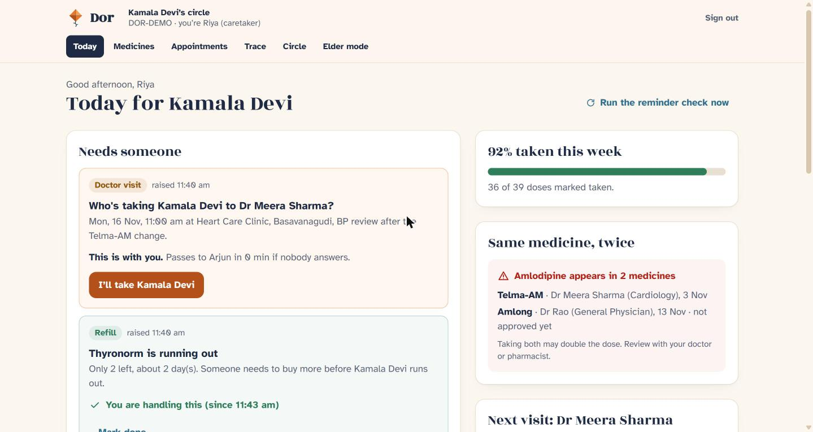
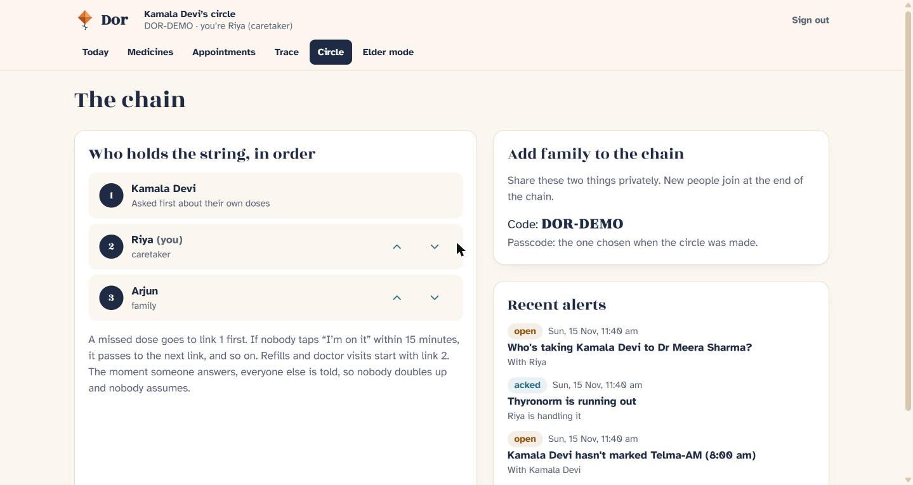
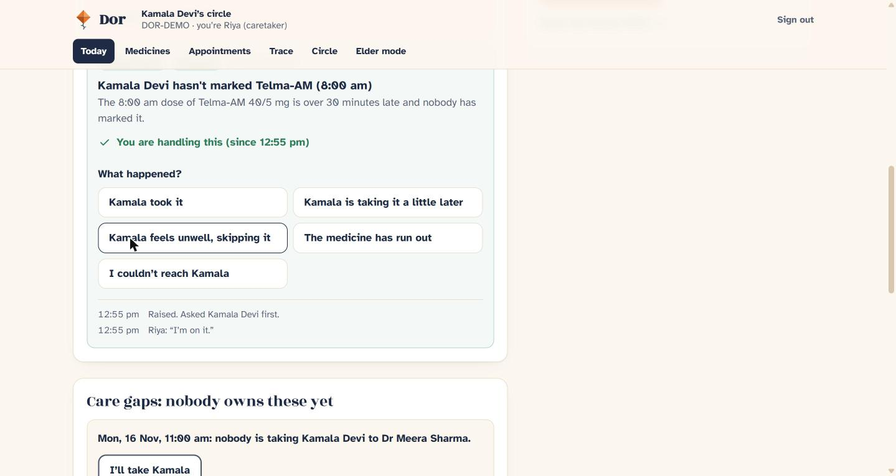
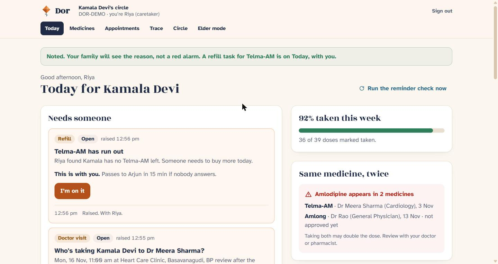
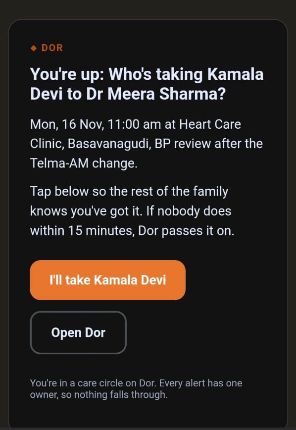
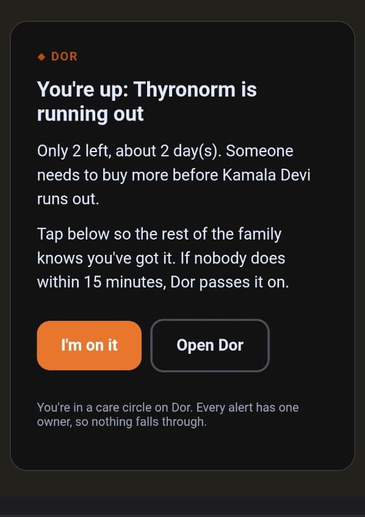
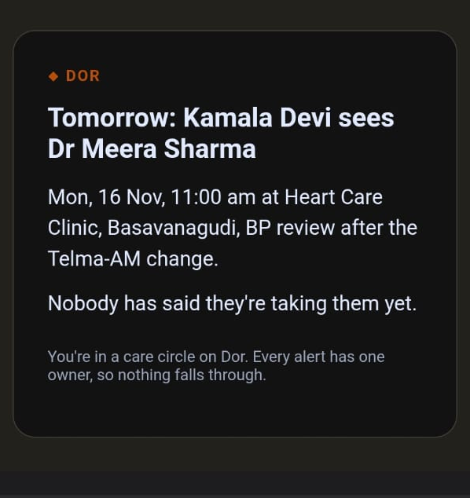
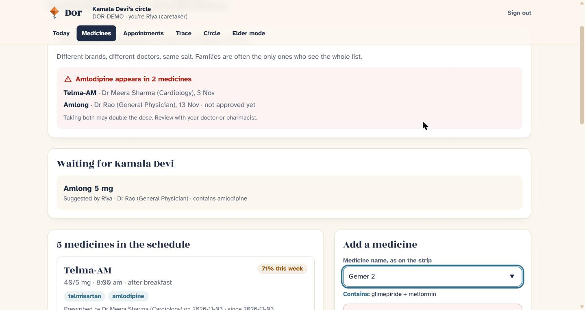
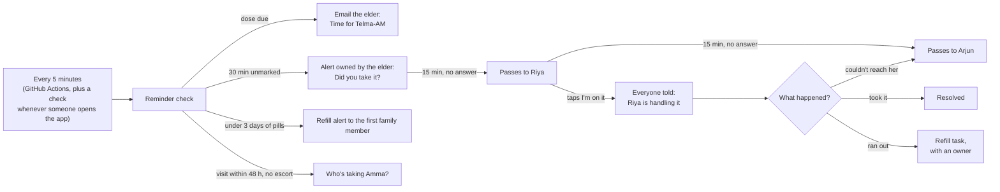

<p align="center">
  
</p>

<h1 align="center">Dor · डोर</h1>

<h3 align="center">Every care event has an owner.</h3>

<p align="center">
  <em>Amma flies her own kite. Dor makes sure someone is always holding the string.</em>
</p>

<p align="center">
  A care circle for an elder’s medicines and doctor visits, where every missed dose has an owner,<br/>
  every prescription is checked against the others, and the elder stays in charge.
</p>

<p align="center">
  <a href="https://dor-sandy-two.vercel.app"><b>Open the live app</b></a>
  &nbsp;·&nbsp;
  <a href="https://dor-sandy-two.vercel.app/#demo"><b>Try the demo (no sign-up)</b></a>
  &nbsp;·&nbsp;
  <a href="#features">Features</a>
  &nbsp;·&nbsp;
  <a href="#how-it-works">How it works</a>
</p>

<p align="center">
  
</p>

---

## Why Dor exists

Medication reminder apps already exist. Family dashboards already exist. What still goes wrong for elders is simpler, and more human:

| What goes wrong | What Dor does about it |
|---|---|
| **Nobody owns the alert.** A missed-dose message reaches four siblings and each assumes someone else called Amma. | **Hold:** every alert has exactly one owner at a time, and it moves down the family chain until someone says *“I’m on it”*. |
| **Nobody sees the whole prescription list.** Three doctors, three prescriptions: Telma-AM already contains amlodipine, so adding Amlong doubles it. | **Check:** Dor knows the active ingredient (salt) behind common Indian brands and flags the same salt arriving twice, naming both doctors. |
| **Nobody connects how she feels to what changed.** “She’s been dizzy” reaches the doctor without “since the dose went up”. | **Trace:** symptoms are lined up against every medicine change, then printed on a one-page **Doctor Brief**. |
| **One person quietly becomes the full-time caregiver.** The daughter nearby handles everything; nobody notices until she burns out. | **Care load:** Dor shows who has carried each care event this month, and lets the family hand over the string when someone travels. |
| **Care turns into surveillance.** The elder becomes a red “MISSED” on someone else’s phone. | **The elder stays in charge:** they are asked first, approve every change, and can choose to skip with a reason. |

> **Try it in 30 seconds.** Open the [live app](https://dor-sandy-two.vercel.app/#demo) and press **Enter as Riya (caretaker)** to see the family view, or **Enter as Kamala (elder mode)** to see what the elder sees. The demo is Kamala Devi, 74: three doctors, a daughter (Riya) who is her caretaker, and a son (Arjun) in Pune.

---

<a id="features"></a>

## Features

### 1. Hold: one owner for every moment

<p align="center">
  
</p>

The **Today** page opens on *Needs someone*: every open alert, who it is with right now, and how long until it passes on.

- **Missed doses.** If a dose isn’t marked within 30 minutes, Dor asks the **elder first** (“Did you take it?”). No answer in 15 minutes, it goes to the next person in the chain, then the next.
- **Refills.** When a strip has under 3 days left, Dor asks *“who’s buying more?”*, starting with the first family member.
- **Doctor visits.** Two days before a visit with nobody taking them, Dor asks *“who’s taking Amma?”*.
- **“I’m on it.”** The moment one person taps it, in the app or straight from the email, escalation stops and **everyone else is told who is handling it**. Nobody doubles up, nobody assumes.

<p align="center">
  
</p>

The **Circle** page shows the chain itself: the elder is always link 1, and the family can reorder everyone else.

#### Every care event has a life: open → claimed → what happened → resolved

<p align="center">
  
</p>

Claiming an alert isn’t the end. Whoever said *“I’m on it”* is asked **what happened**, in one tap:

| Choice | What Dor does |
|---|---|
| **Kamala took it** | Marks the dose taken and closes the event. |
| **Taking it a little later** | Keeps it with you until the dose is marked. |
| **Feels unwell, skipping it** | Records the skip with the reason, which feeds Trace. |
| **The medicine has run out** | Records why, sets the stock to zero, and **opens a refill task** with an owner. A memory problem and a supply problem are different problems. |
| **I couldn’t reach her** | **Passes the event to the next person straight away**, with your note, instead of waiting 15 minutes. |

<p align="center">
  
</p>

Every step is written to the event’s **trail**: raised, asked the elder first, passed on, claimed, the outcome, resolved. The Circle page keeps the full history of every care event, start to finish.

#### Care gaps: fix failures before they happen

The Today page also lists what is coming up **with nobody responsible**: a doctor visit in the next 7 days with nobody taking her, a strip running out that nobody has said they’ll buy, a medicine change waiting on the elder for over a day, or a chain with only one person after the elder. Each gap has a one-tap fix (*I’ll take her*, *I’ll buy it*, *Invite a backup*).

#### Care load: who is carrying it

The Circle page counts each family member’s care events over 30 days (alerts claimed, visits taken, refills bought) and shows them as bars. When one person carries 60% or more, Dor says so plainly (*“Riya has handled 81% of care events in the last 30 days”*) and offers one tap to let someone else take the first call.

#### Handoff: hand over the string when you travel

*“I’m away 15–17 Nov, Arjun covers.”* While someone is away, Dor skips them in the chain. Their open events and any future visits they were taking move to their cover, with a trail entry on each (handoffs that start on a later day are applied by the reminder check on that day). The cover gets one email with a **briefing written by Google Gemini** from Dor’s records: what is now theirs, the daily medicine routine, and recent skip reasons. The briefing is labelled as not medical advice, and Dor falls back to a plain-text version if Gemini isn’t available. *I’m back* restores the chain.

### 2. Emails you can act on

Every reminder is a real email with one-tap buttons. Nobody needs to open the app to respond.

<table>
  <tr>
    <td width="25%" valign="top"></td>
    <td width="25%" valign="top"></td>
    <td width="25%" valign="top"></td>
    <td width="25%" valign="top"></td>
  </tr>
  <tr>
    <td align="center"><sub><b>The elder is asked first.</b><br/>“I took it” or “I chose to skip”.</sub></td>
    <td align="center"><sub><b>An errand finds an owner.</b><br/>One tap claims the visit.</sub></td>
    <td align="center"><sub><b>Refills before they run out.</b><br/>Passed on if nobody answers.</sub></td>
    <td align="center"><sub><b>Visit reminders</b><br/>24 hours and 2 hours before.</sub></td>
  </tr>
</table>

After *“I’m on it”*, the same page goes straight on to **“What happened?”**, so the email carries the whole care workflow. Most events never need the app opened.

Email buttons open a short confirm page, and only the button on that page acts. Mail scanners that pre-open links can’t press anything by accident, and links expire after 24 hours.

### 3. Check: same salt, different brand

<p align="center">
  
</p>

Type a medicine the way it’s printed on the strip (*“Gemer 2”*, *“TELMA-AM 40”*, *“dolo650”*). Dor shows what’s inside it and **warns while you type** if any ingredient is already in another medicine, naming the prescribing doctor. About 150 common Indian brands are mapped, including combinations like Telma-AM, Glycomet-GP and Ecosprin-AV. For a brand Dor doesn’t know, it asks for the ingredient printed under the name.

<p align="center">
  
</p>

The Medicines page keeps a standing warning for every duplicate, with each doctor and date, so the family can raise it at the next visit.

### 4. Trace and the Doctor Brief

<p align="center">
  
</p>

**Why doses were missed.** Trace also splits the last 30 days of missed doses by reason: never marked, felt dizzy, ran out… and says what that means (*“Most misses were supply problems, not memory. Watch the refills.”*). The family learns whether they have a reminder problem or a refills problem.

Anyone in the circle can log how the elder feels in one tap (dizziness, swollen feet, nausea…). Reasons given for skipping a dose, like *“felt dizzy”*, are logged too. **Trace** lines all of it up against every medicine change and points out symptoms that first appeared within 7 days of a change. Dor doesn’t diagnose; it shows the timing so the doctor can judge.

<p align="center">
  
</p>

Every appointment has a printable **Doctor Brief**: current medicines with their ingredients and prescribers, 30-day adherence per medicine, duplicate warnings, symptoms that began after a change, doses skipped in the elder’s own words, and questions the family collected for the doctor.

### 5. The elder stays in charge

<p align="center">
  
</p>

- **Elder mode** shows one thing at a time: the next medicine, in large type, with two big buttons and **Read it to me** (the browser’s own voice, no extra service).
- **Approval.** When family adds or changes a medicine, it waits as *pending* until the elder approves it. Nothing enters their schedule behind their back.
- **“I chose to skip”** is a valid answer. Family sees the reason (*“felt dizzy”*), not a red alarm, and the reason feeds Trace.
- Set in **Atkinson Hyperlegible**, a typeface designed for low-vision readers.

### 6. A shared circle with a passcode

One person creates a circle for the elder and gets a code like `DOR-4F7K`. Family and caretakers join with the code and the shared passcode. Passcodes are hashed, and five wrong tries pause the circle for 10 minutes.

---

## Problem-statement checklist

| Requirement | Where it lives in Dor |
|---|---|
| Shared profile with secure, passcode-based access | Start or join a circle (code + passcode, scrypt-hashed, lockout after 5 tries) |
| View, add, edit and manage medication schedules | Medicines page; every change is a new version the elder approves |
| Track adherence | Today (7-day %), per medicine, and 30-day table on the Doctor Brief |
| Monitor upcoming doctor appointments | Appointments page, escort claiming, questions for the doctor |
| Email reminders: upcoming doses, missed doses, appointments | Dose reminders, missed-dose alerts with escalation, 24 h / 2 h visit reminders, refill alerts, all with one-tap buttons |
| Elder at the centre of their own decisions | Asked first, approves changes, can skip with a reason, Elder mode |

---

## Google services, and why each one is there

| Service | What it does in Dor | Where |
|---|---|---|
| **Gemini API** | **Gemini generates caregiver handoff briefings from structured care events; it does not diagnose or recommend medication changes.** When someone hands over their part of the chain, Dor sends Gemini the facts it already holds (the open items moving to the cover, the daily medicine routine, recent skip reasons) and emails the result to the person covering. Ownership, escalation, reminders and duplicate-ingredient checks are deterministic code; Gemini never decides anything. The prompt forbids advice, diagnosis and medicine changes; only the elder’s first name, medicine names and times are sent; the briefing is labelled “Written by Google Gemini… Not medical advice”; and a deterministic plain-text briefing is used if the key is missing or the call fails. It calls Google’s REST endpoint (`generateContent`, model `gemini-3.1-flash-lite`) with the built-in `fetch`, so no SDK dependency is added. Set `GEMINI_API_KEY` to enable it. | [`lib/gemini.ts`](lib/gemini.ts) |
| **Google Calendar** | **A generated “Add to Google Calendar” link, not an API sync.** Every doctor visit, and the email sent to whoever claims one, has a link built from Calendar’s event-template URL (`calendar.google.com/calendar/render?action=TEMPLATE…`). Opening it pre-fills an event whose title names the person responsible (*“Kamala’s visit to Dr Meera Sharma: Arjun taking Kamala”*); the person saves it to their own calendar. Dor doesn’t use OAuth, store tokens, or read or write anyone’s calendar, and the event carries no medical detail. | [`lib/gcal.ts`](lib/gcal.ts) |
| **Gmail** | Sends every reminder and alert, with one-tap actions. | [`lib/mail.ts`](lib/mail.ts) |
| **Google Fonts** | Atkinson Hyperlegible (designed for low-vision readers) and Rozha One, self-hosted at build time via `next/font`. | [`app/layout.tsx`](app/layout.tsx) |

---

<a id="how-it-works"></a>

## How it works



- **Next.js 15** (App Router, server components and server actions), deployed on **Vercel**.
- **Postgres on Neon**, queried with parameterised tagged templates. Schema in [`db/schema.sql`](db/schema.sql).
- **Email** through Gmail SMTP, capped per recipient and per day so the sending account stays in good standing.
- **The reminder check** ([`lib/tick.ts`](lib/tick.ts)) runs every 5 minutes from a [GitHub Actions workflow](.github/workflows/tick.yml), because Vercel’s free plan allows only a daily cron. As a backup, it also runs (at most once per 5 minutes) when someone opens the app. It is idempotent: overlapping runs never send an email or raise an alert twice.
- **Layout.** Pages are server components in [`app/p/`](app/p); every write is a server action in [`app/actions.ts`](app/actions.ts) that re-checks the session and validates input ([`lib/validate.ts`](lib/validate.ts)). Care logic lives in [`lib/care.ts`](lib/care.ts), alert creation and trails in [`lib/alerts.ts`](lib/alerts.ts), and decisions that can be pure (timing, escalation, gaps, care load, salts, trace flags) are pure functions in [`lib/`](lib).

## Security

| Concern | What Dor does |
|---|---|
| Passcodes | scrypt with a per-circle salt, compared in constant time ([`lib/passcode.ts`](lib/passcode.ts)). |
| Brute force | The attempt is counted *before* the hash check, in one atomic update, so parallel guesses can’t skip it: the 5th wrong try pauses the circle for 10 minutes (tested live with 12 simultaneous guesses: 5 got through). The demo circle is exempt because its passcode is public. |
| Sessions | HMAC-signed, expiring, `httpOnly`, `SameSite=Lax`, `Secure` in production. Email-action tokens are rejected as sessions. |
| Authorisation | Every server action and page loads the circle from the session and scopes every query by `profile_id`; ids from forms are UUID-checked first. The elder-only actions (approve, decline, stop a medicine) are checked on the server. |
| Email links | Signed with HMAC, expire in 24 hours, bound to one member and one alert or dose. Opening a link only shows a confirm page; the action happens on POST, so mail scanners can’t trigger it. Actions are idempotent (repeating one changes nothing). |
| Database | Parameterised tagged templates only. Concurrency-sensitive writes are single statements (claiming, escalation, dose marking with a locked read). |
| Abuse | Per-recipient (40/day) and global (400/day) email caps; caps on dose times, medicines, visits and circle size. |
| Headers | `X-Frame-Options: DENY`, `frame-ancestors 'none'`, `Referrer-Policy: same-origin`. |
| Secrets | Only in Vercel and GitHub encrypted settings; `.env*` is ignored and the git history has none. |
| Dependencies | `npm audit --omit=dev`: **0 vulnerabilities** (PostCSS pinned to a patched version via `overrides`). Six moderate advisories remain in dev-only lint tooling. |

## Testing

`npm test` runs **70 unit tests** in [`tests/`](tests), covering dose timing and missed-dose classification, escalation and the elder-first chain, handoff duty rules, care gaps, care load, the “What happened?” outcomes, brand → ingredient matching and duplicates, Trace flags (calendar days, windows), signed tokens (tampered, expired, garbage), passcodes, open-redirect and input validation, the Google Calendar link and the Gemini prompt and fallback.

Behaviour that depends on the database (claim races, lockout under parallel guesses, single pill decrement under concurrent taps, refill re-raising) was verified against the live Neon database during development; those checks aren’t yet automated.

## Accessibility and performance (measured)

Lighthouse 12 against the live deployment:

| Page | Accessibility | Performance | Best practices | SEO |
|---|---|---|---|---|
| Home | **100** | 98 | 100 | 100 |
| Today (signed in) | **100** | 96 | 100 | 100 |
| Elder mode (signed in) | **100** | – | – | – |

Labels on every control, visible focus rings, contrast checked, 44px+ touch targets, a reduced-motion fallback for the one animation, and no colour-only status (every status has a word). Every query has a matching index ([`db/schema.sql`](db/schema.sql)), and the one-off tables are cleaned by the reminder check.

## Run it locally

```bash
npm install
cp .env.example .env.local          # DATABASE_URL, SESSION_SECRET, CRON_SECRET, SMTP_USER, SMTP_PASS
npm run db:migrate
DEMO_EMAIL=you@gmail.com npm run db:seed   # optional: the Kamala Devi demo circle
npm run dev                          # http://localhost:3000
npm test
```

`SMTP_PASS` must be a Gmail **app password** (Google Account → Security → 2-Step Verification → App passwords), not your normal password. `GEMINI_API_KEY` is optional (from Google AI Studio); without it, handoff briefings use the plain-text fallback.

Deploy: push to Vercel, connect Neon from the Storage tab, set the variables above, and add `CRON_SECRET` and `DOR_URL` as GitHub Actions secrets for the reminder workflow.

## Limits we know about

- Dor helps a family coordinate. It is **not medical advice**. The brand list is a curated safety net, not a formulary.
- All circles run on India Standard Time.
- GitHub’s 5-minute schedule can run late, or not start for hours on a new repository. Opening the app, or **Run the reminder check now** on the Today page, runs it immediately, and the manual [reminder loop](.github/workflows/tick-loop.yml) keeps it running every 5 minutes for 6 hours.
- On Gemini’s free tier, Google may use prompts to improve its products. Dor sends only the elder’s first name, medicine names and times and open items; for real families, use a paid key.
- Handoffs don’t yet ask the cover to accept, and doctor questions can’t yet be marked answered.
